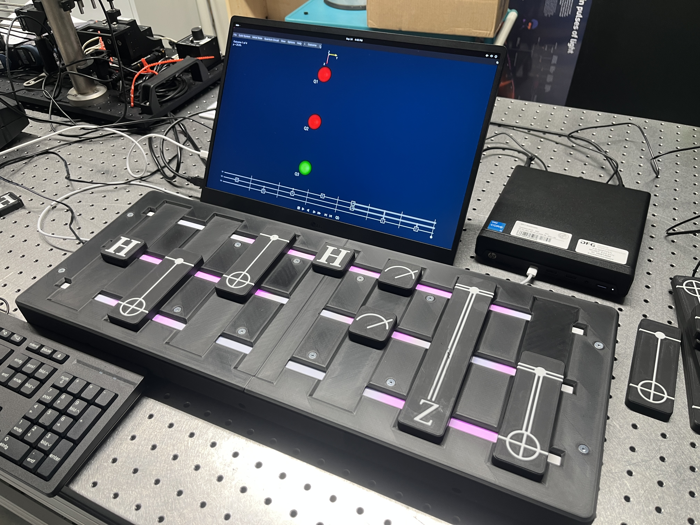

# Quantum-Demonstrator-Lite
A Plug and play Quantum Algorythm for Students. Integrates into SpinDrops, a software for visualising up to three Qubits, with fully customisable Quantum Gates.

*Picture of the Setup used in the Max Planck Institute of Quantum Optics*

The Quantum Demonstrator Lite can be used to demonstrate algorithms up to three Qubits over seven positions, and these can be viewed in Detail with the Spin Drops Software, available at https://spindrops.org/2.5.0-beta1/download.html *(We recommend going with the Beta, as it has the updated visualisation)*

The Quantum Demontrator Lite utilises 21 RC522 readers to maximise flexibility with the Quantum gates, allowing you to create your own custom gates. These are being controlled by a Raspberry Pi Pico2 Microcontroller, which in turn communicates with the PC over USB. 

## Getting Started
For anybody wanting to build the Demonstrator, you should have a few prerequisite Tools:
| Tool | |
| --- | --- |
| 3D Printer | Ideally one with a Printbed bigger than 300x250, but 250x250 can also accomodate all parts. The ability to Print Mulit Colour is also very Helpful for printing the Gates|
| Soldering Iron | A fine tipped Soldering Station/Iron is necesary, should you decide to assemble the PCB yourself, Solder flux, tweezers, tin snips and more standard Soldering tools are required|
| Hex Bits | A standard Metric Set of Hex bits |

*Note: Should you decide to assemble the PCB yourself, be aware the SMD components are not the easiest to work with. A revamped version is a WIP which will drasitcally reduce the amount of components needed*

## Electronics
|[`Electronics/`](Electronics/README.md) contains the PCB Schematic and Board design. The PCB was designed in KiCad.
Parts needed for the PCB can be found via the Schematics, the BOM or here.

| ID | Designator | Value/Component | Footprint | Qty | Source | Cost |
|:---:|:---|:---|:---|:---:|:---|:---:|
| 1 | A2 | Rapberry Pi Pico 2 | Pico SMD | 1 | [Conrad](https://www.conrad.de/de/p/raspberry-pi-pico-2-mikrocontroller-pico-2-3305690.html) | 5€ |
| 2 | Cbst1, Cbst2 | 100nF | 0805 SMD | 2 | [Supplier](URL) | |
| 3 | Cin1, Cin2  Cin3, Cin4 | 10µF | 0805 SMD | 2 | [Supplier](URL) | |
| 4 | Cout1, Cout2, Cout3 | 22µF | 0603 SMD | 3 | [Supplier](URL) | |
| 5 | Cout4 | 47µF | 1206 SMD | 1 | [Supplier](URL) | |
| 6 | F1 | 5A Fuse | 1206 SMD | 1 | [Supplier](URL) | |
| 7 | J1 | USB-C 16Pin | USB-C 16P | 1 | [Supplier](URL) | |
| 8 | J4 | Barrel Jack | Barrel Jack | 1 | [Digikey](https://www.digikey.de/de/products/detail/w%C3%BCrth-elektronik/694106301002/5047522?s=N4IgTCBcDaIGwE4AsBGADHAzG9aIF0BfIA) | 1€ |
| 9 | L1 | 2.2µH | ANR6045 SMD | 1 | [Supplier](URL) | |
| 10 | L2 | 4.7µH | 1008 SMD | 1 | [Supplier](URL) | |
| 11 | PCBconn1.1–3.2 | Molex Miligrid 4x2 | 08x04 THT | 4 | [Digikey](https://www.digikey.de/de/products/detail/molex/0878310820/679677) | 7,50€ |
| 12 | PCBconn1.1–3.2 | Molex Miligrid 4x2 | 08x04 THT | 2 | [Digikey](https://www.digikey.de/de/products/detail/molex/0878330831/2405183) | 5€ |
| 13 | R1, R2 | 5.1kΩ | 0805 SMD | 1 | [Supplier](URL) | |
| 14 | R3 | 160 Ω | 0805 SMD | 1 | [Supplier](URL) | |
| 15 | R6 | 100kΩ | 0805 SMD | 1 | [Supplier](URL) | |
| 16 | Rfbb1, Rfbb2 | 10kΩ | 0805 SMD | 2 | [Supplier](URL) | |
| 17 | Rfbt1 | 33.2kΩ | 0805 SMD | 1 | [Supplier](URL) | |
| 18 | Rfbt2 | 56.2kΩ | 0805 SMD | 1 | [Supplier](URL) | |
| 19 | SW2 | Switch with LED | R1966 SW SMD | 1 | [Digikey](https://www.digikey.de/de/products/detail/e-switch/R1966ABLKBLKESRED/251346?s=N4IgTCBcDaIEoEYCcA2FBBAQgGQNI9wFEBlOQgERAF0BfIA) | 2,50€ |
| 20 | U1 | TPS563200DDCR | SOT-23-6 SMD | 1 | [Supplier](URL) | |
| 21 | U2 | TPS561201DDCR | SOT-23-6 SMD | 1 | [Supplier](URL) | |

