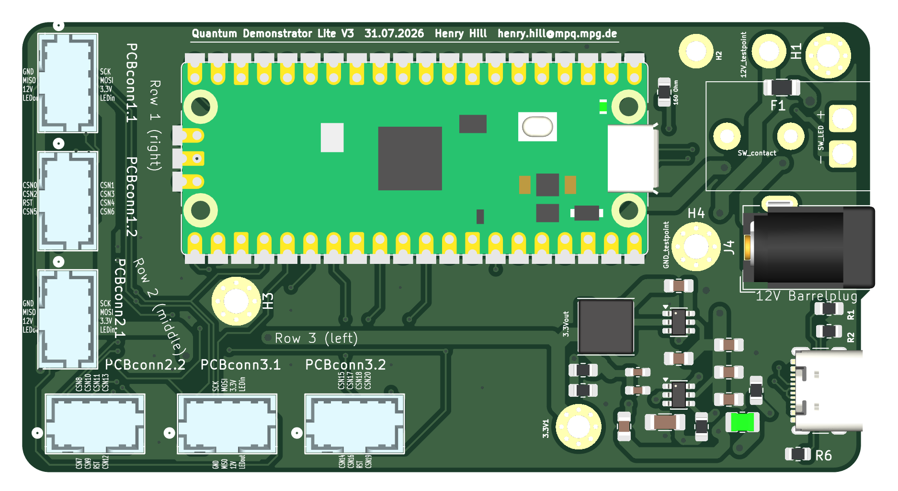
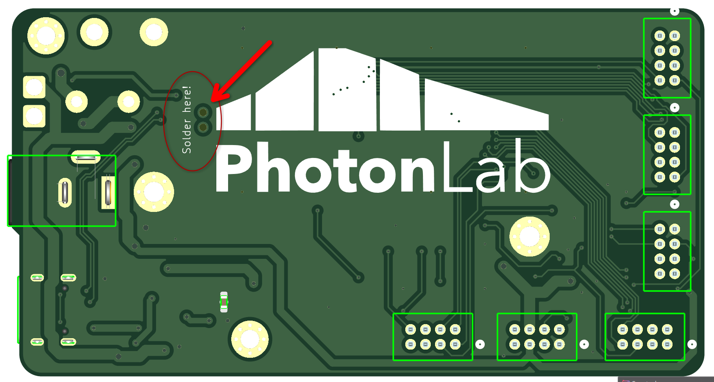
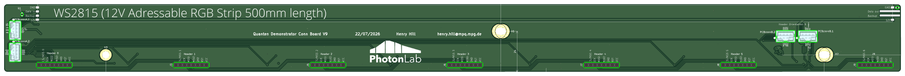

# Quantum-Demonstrator-Lite
A Plug and play Quantum Algorythm for Students. Integrates into SpinDrops, a software for visualising up to three Qubits, with fully customisable Quantum Gates.

*Picture of the Setup used in the Max Planck Institute of Quantum Optics*

The Quantum Demonstrator Lite can be used to demonstrate algorithms up to three Qubits over seven positions, and these can be viewed in Detail with the Spin Drops Software, available at https://spindrops.org/2.5.0-beta1/download.html *(We recommend going with the Beta, as it has the updated visualisation)*

The Quantum Demontrator Lite utilises 21 RC522 readers to maximise flexibility with the Quantum gates, allowing you to create your own custom gates. These are being controlled by a Raspberry Pi Pico2 Microcontroller, which in turn communicates with the PC over USB. 

It was designed to be somewhat affordable to institutions and Schools, with a price around 400€ depending of the suppliers you choose, and the means of assembly.

## Getting Started
For anybody wanting to build the Demonstrator, you should have a few prerequisite Tools:
| Tool | |
| --- | --- |
| 3D Printer | Ideally one with a Printbed bigger than 300x250, but 250x250 can also accomodate all parts. The ability to Print Mulit Colour is also very Helpful for printing the Gates|
| Soldering Iron | A fine tipped Soldering Station/Iron is necesary, should you decide to assemble the PCB yourself, Solder flux, tweezers, tin snips and more standard Soldering tools are required|
| Hex Bits | A standard Metric Set of Hex bits |

*Note: Should you decide to assemble the PCB yourself, be aware the SMD components are not the easiest to work with. A revamped version is a WIP which will drasitcally reduce the amount of components needed*

## Electronics
|[`Electronics/`](Electronics/README.md) contains the PCB Schematic and Board design. The PCB was designed in KiCad.
Parts needed for the PCB can be found via the Schematics, the BOM or here.

### Main PCB
The Main PCB contains the Raspberry Pi Pico and all the power conversion needed to power the NFC readers, the LEDs and the Pi Pico itself.

| ID | Designator | Value/Component | Footprint | Qty | Source | Cost |
|:---:|:---|:---|:---|:---:|:---|:---:|
| 1 | A2 | Rapberry Pi Pico 2 | Pico SMD | 1 | [Conrad](https://www.conrad.de/de/p/raspberry-pi-pico-2-mikrocontroller-pico-2-3305690.html) | 5€ |
| 2 | Cbst1, Cbst2 | 100nF | 0805 SMD | 2 | [Supplier](URL) | |
| 3 | Cin1, Cin2  Cin3, Cin4 | 10µF | 0805 SMD | 4 | [Supplier](URL) | |
| 4 | Cout1, Cout2, Cout3 | 22µF | 0603 SMD | 3 | [Supplier](URL) | |
| 5 | Cout4 | 47µF | 1206 SMD | 1 | [Supplier](URL) | |
| 6 | F1 | 5A Fuse | 1206 SMD | 1 | [Supplier](URL) | |
| 7 | J1 | USB-C 16Pin | USB-C 16P | 1 | [Supplier](URL) | |
| 8 | J4 | Barrel Jack | Barrel Jack | 1 | [Digikey](https://www.digikey.de/de/products/detail/w%C3%BCrth-elektronik/694106301002/5047522?s=N4IgTCBcDaIGwE4AsBGADHAzG9aIF0BfIA) | 1€ |
| 9 | L1 | 2.2µH | ANR6045 SMD | 1 | [Supplier](URL) | |
| 10 | L2 | 4.7µH | 1008 SMD | 1 | [Supplier](URL) | |
| 11 | PCBconn1.1–3.2 | Molex Miligrid 4x2 | 08x04 THT | 4 | [Digikey](https://www.digikey.de/de/products/detail/molex/0878310820/679677) | 7,50€ |
| 12 | PCBconn1.1–3.2 | Molex Miligrid 4x2 | 08x04 THT | 2 | [Digikey](https://www.digikey.de/de/products/detail/molex/0878330831/2405183) | 5€ |
| 13 | R1, R2 | 5.1kΩ | 0805 SMD | 1 | [Supplier](URL) | |
| 14 | R3 | 160 Ω | 0805 SMD | 1 | [Supplier](URL) | |
| 15 | R6 | 100kΩ | 0805 SMD | 1 | [Supplier](URL) | |
| 16 | Rfbb1, Rfbb2 | 10kΩ | 0805 SMD | 2 | [Supplier](URL) | |
| 17 | Rfbt1 | 33.2kΩ | 0805 SMD | 1 | [Supplier](URL) | |
| 18 | Rfbt2 | 56.2kΩ | 0805 SMD | 1 | [Supplier](URL) | |
| 19 | SW2 | Switch with LED | R1966 SW SMD | 1 | [Digikey](https://www.digikey.de/de/products/detail/e-switch/R1966ABLKBLKESRED/251346?s=N4IgTCBcDaIEoEYCcA2FBBAQgGQNI9wFEBlOQgERAF0BfIA) | 2,50€ |
| 20 | U1 | TPS563200DDCR | SOT-23-6 SMD | 1 | [Supplier](URL) | |
| 21 | U2 | TPS561201DDCR | SOT-23-6 SMD | 1 | [Supplier](URL) | |

For a complete PCB assembbly service, you can expect to pay ~85€ 

Parts 1, 8, 11, 12 and 19 will have to be hand soldered. Numbers 8, 9 and 12 are Normal THT components, 19 has to be wired and then soldered.
The Raspberry Pi Pico2 has an Unusual way of soldering it to the PCB, due to the assumption one doesn't have a hotplate available.

| Top Side | Bottom Side |
|:--:|:--:|
||
||*Marked by the red Arrow are two through Holes, **these must be kept unfilled**, double check this when ordering the PCB* 

First solder down two of the SMD Pads of the Pi Pico, then turn the board around and fill the Marked through holes with solder, make sure to keep it warm for a bit, and probe the PCB for connection between the USB and the data pins on the Pi Pico.

### Connecting PCBs
The Quantum Demonstrator uses three almost identical PCBs to connect the individual NFC Readers to the Main PCB. These Connecting PCBs also mount the LEDs for the illumination. While all of the Connecting PCBs are the same, the Placement of the connectors is different for one of the three boards. 
These connectors are labeled with A.1, A.2 and B.1, B.2. This is neccessary due to cabeling and space saving.

**Two Boards must be configured with the A.1 and A.2 ports soldered and one Board with the B.1 and B.2 ports**

**QD_main PCB**

For all three Connection PCB, you will need:
| ID | Designator | Value/Component | Footprint | Qty | Source | Cost |
|:---:|:---|:---|:---|:---:|:---|:---:|
| 1 | LEDStrip1 5m | WS2815 12V LED Strip | 500x10mm | 1 | [Amazon](https://www.amazon.de/-/en/SEZO-Upgraded-Individually-Addressable-Non-Waterproof/dp/B0DNHVZDY6?) | 25€ |
| 2 | J2-J9 | Conn\_01x08\_Socket | THT | 30 | [Conrad](https://www.conrad.de/de/p/mpe-garry-stiftleiste-standard-anzahl-reihen-1-polzahl-je-reihe-8-087-1-008-0-s-xs0-1260-1-st-734023.html) | 5,50€ |
| 3 | PCBconnA.1 - A.2 | Conn\_02x04\_Counter\_Clockwise | THT | 6 | [Digikey](https://www.digikey.de/de/products/detail/molex/0878330831/2405183) | 13€ |

### Miscelaneous Parts
*Important Note for the NFC readers: **These must be the JoyIT readers, as the pinout is not compatible between different vendors.** The ones we specify have to have straight Through hole connectors, you can desolder the included conneectors or order via JoyIT directly and ask to have these connectors omitted, such that you can solder your own.*

| ID | Designator | Value/Component | Qty | Source | Cost |
|:---:|:---|:---|:---:|:---|:---:|
| 1 | NFC Reader | JoyIT RC522 | 21 | [Conrad](https://www.conrad.de/de/p/joy-it-sbc-rfid-rc522-rfid-set-1-st-1503746.html) | 112€ |
| 2 | Cables 218509-1083 | Molex Milligrid 02x08 locking | 6 | [Mouser](https://www.mouser.de/en/ProductDetail/Molex/218509-1083?qs=A6eO%252BMLsxmQCsrsfTUrgcg%3D%3D) | 25,15€ |
| 3 | NFC Tags | 38 mm - NTAG 213 - 180 Byte | 50 | [NFC-Tag-Shop](https://www.nfc-tag-shop.de/en/NFC-Sticker-PET-38-mm-NTAG-213-180-Byte-white/68261) | 29,50€ |

## Software
The Quantum Demonstrator uses some Embedded and some PC side software. 
### Prerequisites
| Software | |
| --- | --- |
| PlatformIO | A means to flash the C++ onto the RaspberryPi Pico via USB e.g. PlatformIO in VSCodium|
| Python 3.14| or newer. Needed for the PC Side software
| Tkinter 3.14 | or newer. Needed for the GUI on the PC side|

### Embedded Software
